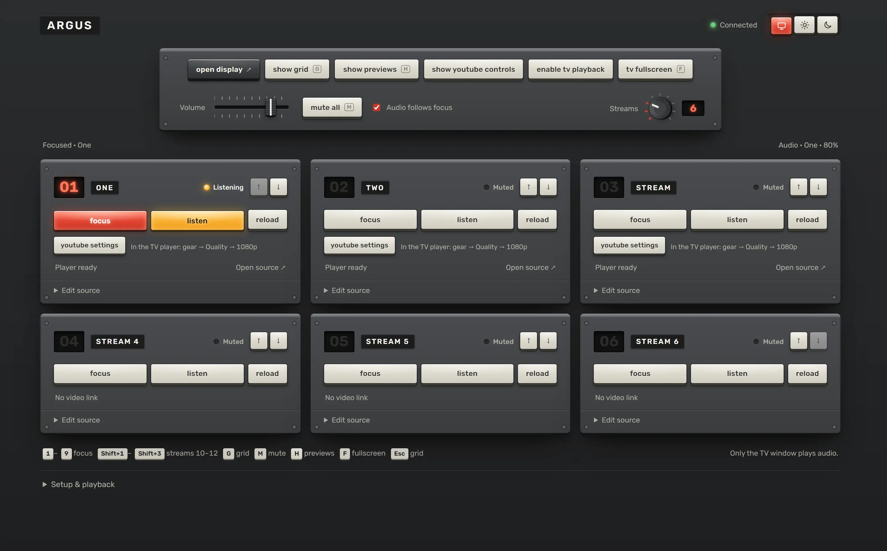

# Argus

Up to twelve streams on one TV, and you pick the one you hear. Argus runs on your own computer, with one window to drive it and another to watch. It's named after the giant with a hundred eyes. Twelve is plenty.



[](https://buymeacoffee.com/letitbedull)

## Start it

You need Node.js 22 or later.

```sh
npm install --ignore-scripts
npm start
```

Open the address it prints and paste in some YouTube links or HLS and DASH streams. Press **open display**, then **listen** on the one you want to hear. Ctrl+C stops it. On Windows, `start.cmd` does both steps for you.

Keys work in either window: 1–9 focus a stream, G goes back to the grid, M mutes, H hides the previews and F makes the TV fullscreen.

## Good to know

Some YouTube videos refuse to be embedded, and nothing here can talk them round. Direct streams need a codec your browser can play and a server that allows cross-origin requests. Only the TV window makes sound.

Ports, settings and fixes live in the [runbook](RUNBOOK.md).

## Working on it

```sh
npm test
npm run test:package
```

The server is `server.mjs`, `state.mjs` and `storage.mjs`. The pages are `app.js`, `index.html`, `display.html` and `style.css`.
